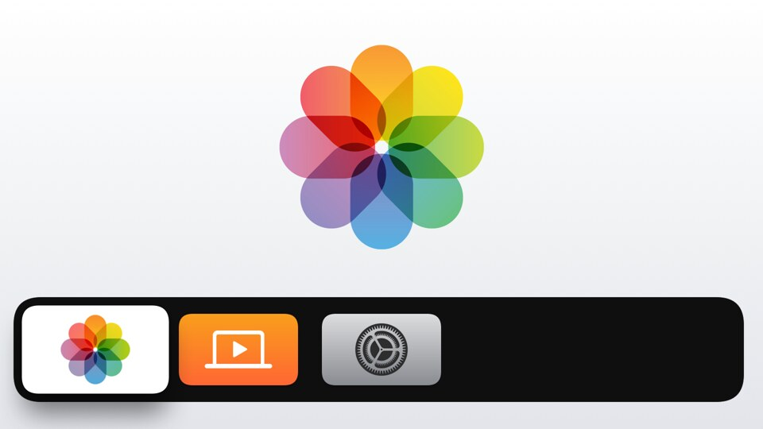
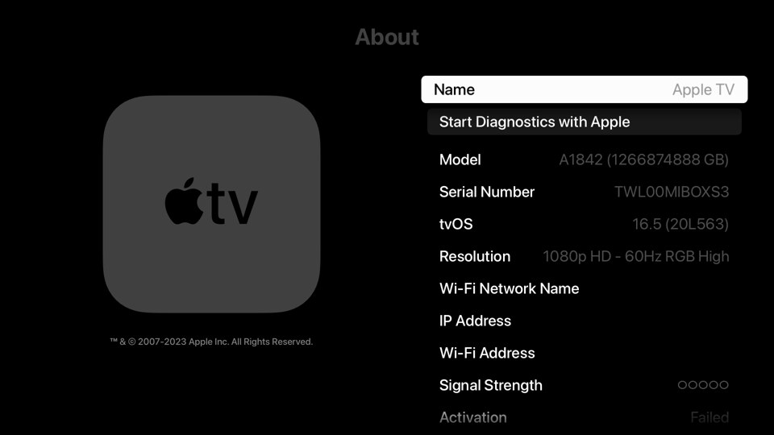

# twilight-xnu

tvOS 16.5 on the Xiaomi Mi Box S 3rd gen (Amlogic S905X5M, `s7d_twilight`), started from USB or from eMMC.

No Apple software is distributed. You should build the stick from your own copy of the tvOS 16.5 OTA for Apple TV 4k (1st Gen).

| | |
|---|---|
|  |  |

## What works

| | |
|---|---|
| Graphics | OpenGL ES and Metal. |
| Hardware video decoding | HEVC, VP9 and H.264 in 1080p and 4K. HDR10 for HEVC and VP9. |
| Video mode switching | The output switches between SDR and HDR and between refresh rates. |
| SDR to HDR | SDR content can be shown in an HDR video mode. |
| Video plane | Decoded frames are sent directly to the display. |
| Multichannel audio | EAC-3 can be decoded and sent to the TV as multichannel PCM. |
| Wi-Fi | Works, at the same speeds as stock Android. |
| Bluetooth | The Mi remote cam be paired from the setup screen, and all of It's buttons are mapped. |
| HDMI-CEC | The TV's remote works, and tvOS can put the TV to sleep. |
| Sleep mode | The box can sleep and wake. |
| CPU and GPU scheduling | Scheduling and throttling for the CPU and the GPU. |

Tested apps: Kodi, YouTube and Minecraft: Apple TV Edition.

## Known issues

- The home screen is a bit laggy. The box has a 1-core GPU, compared to the 12-core GPU of the A10X Fusion on the Apple TV 4k.
- Video playing while an overlay is on top of it may be laggy, as with Apple's Aerial screensaver.
- A playing video may glitch during its resize animation, as in YouTube when its settings open.

## What will not work

- FairPlay and FairPlay Streaming: protected video does not play.
- Apple sign-in: it requires a key from the SEP of a real Apple device, which cannot be extracted.
- AirPlay.
- Dolby Vision: it could technically work, but has not been tested (no Dolby Vision TV was available).
- AV1: the original Apple TV 4K only has software decoding, and apps do not expect AV1 on the box.

## Install

[INSTALL.md](INSTALL.md) has the whole procedure. In short:

1. You need the box with an unlocked bootloader, a USB stick of 8 GB or more, and your own tvOS 16.5 OTA.
2. Build the kernel, the loader and the tvOS system volume, then write the stick with `tools/twl-release.sh`.
3. Run `adb reboot update` from adb, then put the stick in and start the box.

Nothing on the eMMC is written except one variable of U-Boot's environment (`bootcmd`).

## A note on the code

I don't expect the code or tools here to be very human readable, all of the development was done using Opus 5.5 and Fable 5.2. It does stupid things like adding comments in places where they don't belong and creating dozens of random tools that no human will ever understand. I fully expect only AI agents to actually be reading the source code and debugging so I just left it all in there.

## What is here

| | |
|---|---|
| `twloader/` | The loader U-Boot starts: it sets the box up and hands over to the kernel. |
| `tvos/` | What tvOS needs on this box: the libraries loaded into its programs (display, input, audio, video decoding, graphics), the build of the small root image, and notes in `tvos/docs/`. |
| `tools/` | Building the stick, unpacking the OTA, and working with a running box. |
| `rescue/`, `probe/` | A small Linux and a bare-metal probe for looking at the box over USB. |
| `hakios/` | Not in this repository: the kernel, [xnu-kernel-twilight](https://github.com/dvg987/xnu-kernel-twilight), a fork of [HakiOS XNU](https://github.com/oosexgang/hakios-xnu-kernel) with this box's drivers. It is cloned into `hakios/`. |
